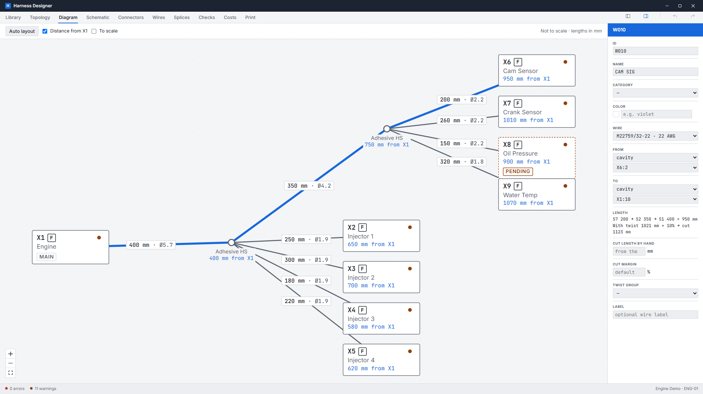
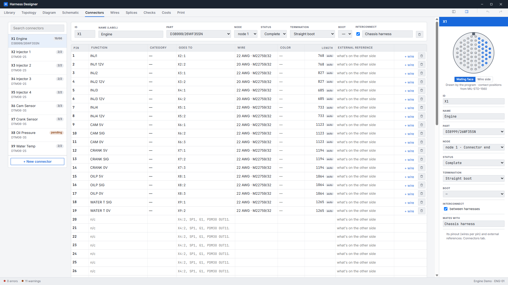
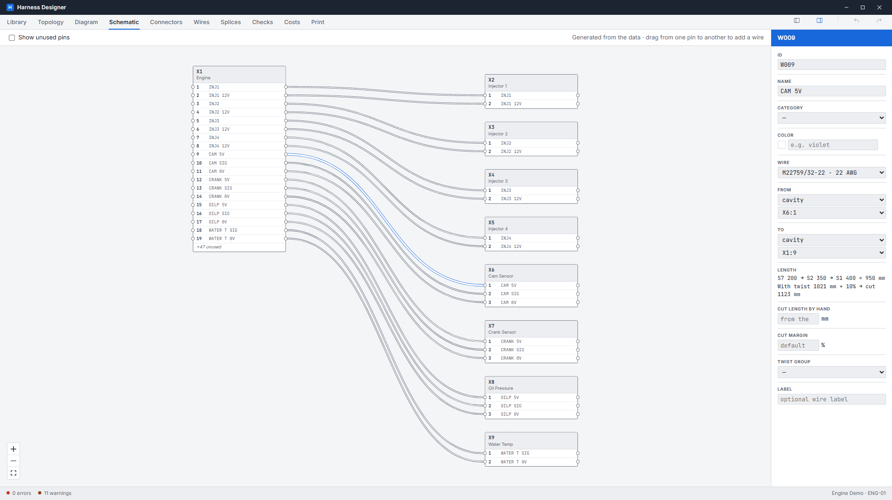
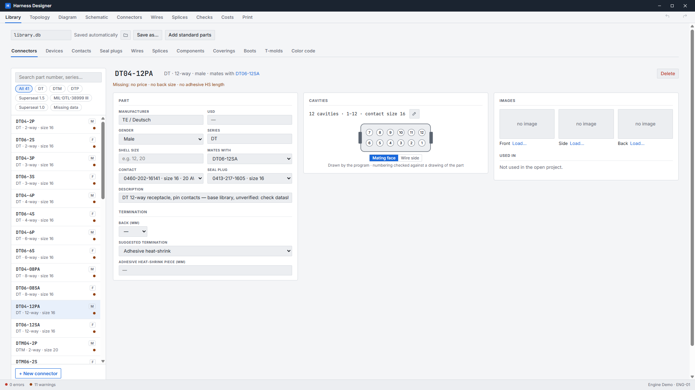
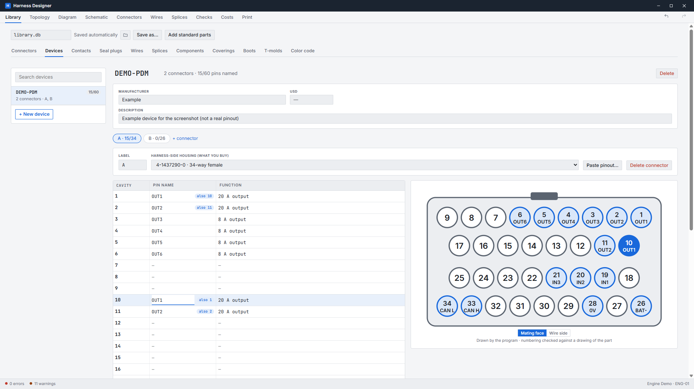
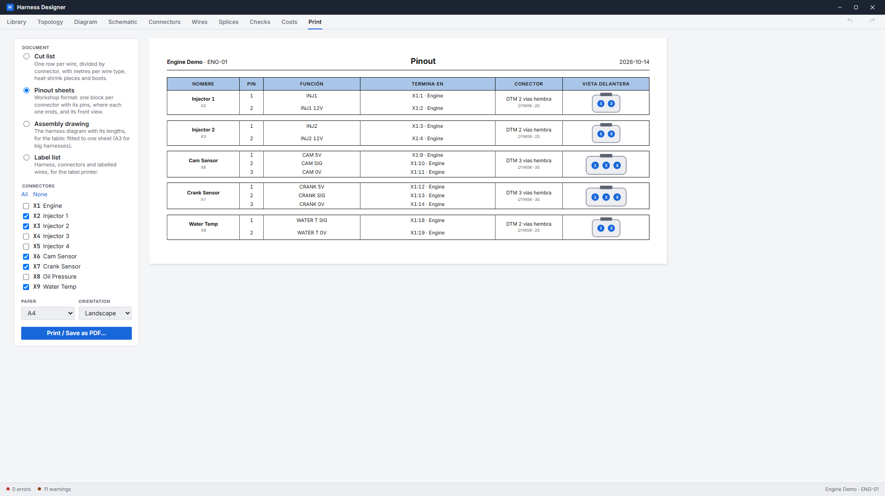
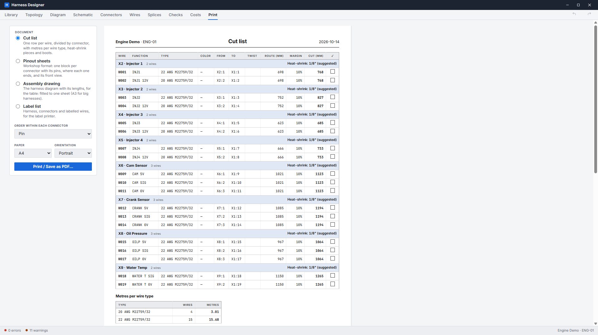
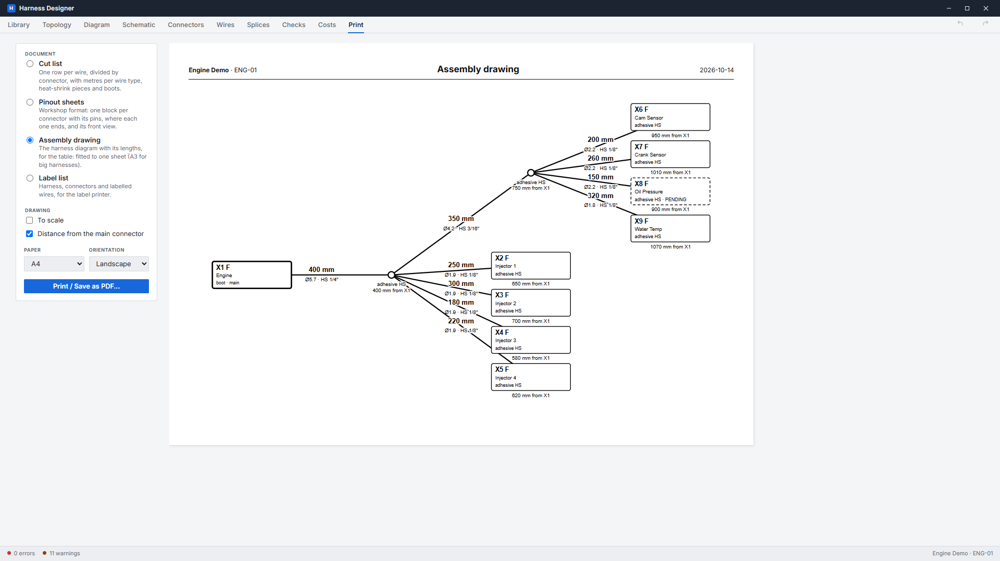

# Harness Designer

Desktop application for designing **motorsport wiring harnesses**: topology and lengths, connectors and their pinouts, cut lengths, heat-shrink sizing, costs, and the printed sheets the workshop builds from.



> **Status:** early test release (0.1.0, Windows). The first real harnesses are being built with it now; expect changes.

## What it does

- **Harness model**: a tree of nodes and segments with real lengths, connectors (or a device's connector, e.g. "PDM · A"), splices, grounds, components, wires and twist groups.
- **Pinout editor**: load the harness connector by connector. Typing in an empty pin creates the wire; "Goes to" accepts `X4:2`, `SP1`, `G1` or a device pin name, with autocompletion. Several wires per pin are supported.
- **Calculations**:
  - cut length per wire, with a twist factor per segment and a margin cascade (project → wire type → wire), or a length set by hand;
  - bundle diameter per segment;
  - suggested heat-shrink and the length to cut;
  - boot and T-mold fit;
  - BOM with spare parts per category and costs.
- **Diagram**: an editable assembly drawing (free or to scale, with cumulative distance from the main connector) and a pin-to-pin schematic generated from the data.
- **Connector faces drawn by the program** for Deutsch DT/DTM/DTP, TE Superseal 1.0/1.5 and MIL-DTL-38999 (contact positions from MIL-STD-1560), with used cavities highlighted.
- **Devices** (PDMs, ECUs, steering wheels): the pinout is pasted straight from the client's spreadsheet or PDF.
- **Checks**: gauge vs. contact range, missing contacts and sealing plugs, splices over capacity, nets with mixed functions, heat-shrink that doesn't fit, broken references, and more.
- **Printing**: workshop-format pinout sheets, a cut list split by connector (colors in words, heat-shrink per block), an assembly drawing fitted to A4/A3, and a label list (also exported as CSV).
- Everything works **offline**. The parts library opens by itself and saves automatically, and undo/redo is available everywhere.

## Screenshots

| | |
|---|---|
|  |  |
| **Connectors**: the editable pinout, with the face of the connector drawn by the program. | **Schematic**: generated from the data, never drawn by hand. |
|  |  |
| **Library**: each part with its contact, sealing plug and face. | **Devices**: pin names on the face, with parallel pins detected (example data). |
|  |  |
| **Pinout sheet**: the workshop's format, one block per connector. | **Cut list**: split by connector, with heat-shrink per block. |



*Assembly drawing for the workbench, with lengths, diameters, heat-shrink sizes and distances from the main connector.*

## Install

Windows 10/11: download `Harness Designer_0.1.0_x64-setup.exe` from [Releases](https://github.com/MartinBinaghi/harness-designer/releases) and run it. It installs per user and doesn't need administrator rights. The WebView2 runtime comes with Windows 11.

The installer isn't code-signed yet, so Windows SmartScreen may say "Windows protected your PC". Click **More info → Run anyway**.

On first start it copies a sample parts library to `%APPDATA%\com.martinbinaghi.arneses\library.db`. From then on, every change to the library is saved automatically. **Topology → Load sample** opens an example engine harness.

## Build from source

Requirements:
- [Rust](https://rustup.rs/) (stable);
- [Node.js](https://nodejs.org/) 24 and [pnpm](https://pnpm.io/);
- the [Tauri prerequisites](https://tauri.app/start/prerequisites/) for your OS.

```bash
pnpm install
pnpm tauri dev      # run in development
pnpm tauri build    # build the installer (src-tauri/target/release/bundle/)
```

Tests:

```bash
cd src-tauri && cargo test           # calculations, checks, file format
node tools/check_sheets.ts           # frontend logic (one script per module in tools/)
```

## Project layout

```
src/                 React + TypeScript UI (screens, sheets, connector faces)
src-tauri/src/       Rust core: model and SQLite files, calculations, checks, undo
src-tauri/schema/    SQLite schemas for projects and libraries
src-tauri/resources/ Sample library and sample harness shipped with the installer
tools/               Logic checks for the frontend, MIL-STD-1560 parser, test helpers
docs/                Decision log (Spanish) and README images
CLAUDE.md            Full design plan (Spanish)
```

A project (one harness) is a single SQLite file. The parts library is a separate file, so it can be shared between projects and machines.

## Data and trademarks

- **Standard parts are unverified.** The library includes standard parts (Deutsch, TE Superseal, M22759/32 wire, Raychem heat-shrink), but it marks them *unverified* until they are checked against the manufacturer's datasheet.
- **Sources for the drawn connector faces:**
  - Deutsch: TE catalogs and drawings.
  - Superseal 1.0: a distributor's rear-view drawing.
  - MIL-DTL-38999: MIL-STD-1560.
- Deutsch, TE, AMP, Superseal, Raychem, MoTeC and other names are trademarks of their owners. This project is not affiliated with them.

## License

© 2026 Martin Binaghi. All rights reserved. The source is public to show the project. No license to use, copy or redistribute it is granted at this time.
